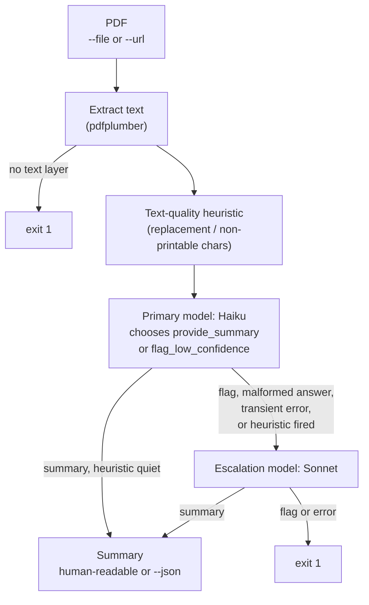

# fia-doc-explainer

Turns an official FIA Formula 1 document — a stewards' decision, the race
director's notes — into a plain-English explanation and a short list of key
facts.

The FIA publishes dozens of PDFs every race weekend (the Mexico City
documents in the test corpus are numbered up to 75), written for teams in
regulatory language: article numbers, "baseline penalty guideline",
"black/white flag". This CLI extracts the text and asks an LLM for a
structured summary through tool use. A cheap model answers by default; a
stronger one takes over when the cheap one fails or flags the input.

Most of the work here is measurement rather than code: every prompt and
schema change was run against a corpus of real FIA documents, with
predictions written down and committed before each run.

## Example

Stewards' decision, Mexico City Grand Prix 2026, document 69
([PDF in the corpus](tests/corpus/02-mexico-gp-car16-left-track-lasting-advantage.pdf)):

```
$ fia-doc-explainer --file tests/corpus/02-mexico-gp-car16-left-track-lasting-advantage.pdf
Document type: Stewards Decision
Model: claude-haiku-4-5

Key facts:
- Charles Leclerc in car 16 for Scuderia Ferrari left the track and gained a lasting
  advantage during the 2026 Mexico City Grand Prix race.
- Leclerc breached Article B1.8.6 of the FIA F1 Regulations by completing an overtake
  while off track.
- Both cars entered turn 4 with excessive speed, meaning neither could have completed the
  corner while staying on track, but Leclerc was not entitled to claim the corner due to
  his excessive entry speed.
- The stewards imposed a 5 second time penalty on Leclerc, reducing from a baseline
  guideline of 10 seconds because car 44 was also off track and the incident occurred
  early in the first lap.

Explanation:
Charles Leclerc in car 16 for Scuderia Ferrari has been given a 5 second time penalty for
the race at the 2026 Mexico City Grand Prix.

The incident happened at turn 4 on the first lap. Leclerc and another car, car 44, both
entered the corner too fast. Neither car could stay on track through the corner at that
speed. Car 44 went off track on the inside, and Leclerc completed an overtake whilst off
track. The stewards ruled that Leclerc was not entitled to claim the corner because he
was going too fast to complete it on the track. Article B1.8.6 (the regulation he broke)
does not allow a driver to gain a lasting advantage by leaving the track.

The stewards said the normal penalty for this breach is 10 seconds. They reduced it to 5
seconds because car 44 was also off track on the inside of Leclerc's car, and because the
incident happened early in the first lap.
```

This is one of the clean answers. About half are not — see [Results](#results).

## How it works



The model is given two tools and must call one of them: `provide_summary`
when it understood the document, `flag_low_confidence` when it did not. Doubt
is a separate action, not a boolean field it fills in by default.

Two independent signals can send a document to the stronger model: the
model's own flag, and a code heuristic on the extracted text. They are kept
in two separate fields of the output, so the results can show which one
actually fires — see [What didn't work](#what-didnt-work).

Not shown: transient API errors are retried before they count as failures,
and a call that hits an exhausted Anthropic balance is repeated on Gemini
(quota fallback). Exit codes: 0 success, 1 the document could not be
processed, 3 missing configuration.

## Results

The corpus is 8 real FIA documents from 4 race weekends: 4 stewards'
decisions, 2 sets of race director's notes and 2 results tables, each
chosen for a specific trap ([tests/corpus/README.md](tests/corpus/README.md)).
Every run below is 8 documents × 3 runs = 24 calls, made by
[scripts/run_corpus.sh](scripts/run_corpus.sh) from a committed state, so
each output is tied to a commit hash.

### Tool-call format: fixed

The first corpus run showed the model breaking its own tool-call format:
`key_facts` arriving as a string with `<parameter name=...>` markup inside,
and in one answer `</invoke>` leaking into the explanation text, where no
validation could see it. The escalation model failed on the same inputs the
same way, so escalation did not help: the failures were correlated.

Strict tool use (`"strict": true`, constrained decoding against the schema)
fixed it:

|                                  | before | after strict |
|----------------------------------|--------|--------------|
| calls that succeeded             | 21/24  | 24/24        |
| structural tool-call failures    | 3      | 0            |
| tool-call markup inside a string | 1      | 0            |
| escalations                      | 3, all failed | 1, succeeded |

### Content: not fixed, and no guard sees it

Every answer was checked by hand against its PDF. In the strict run, **12 of
24 answers contain at least one error** (10 of 21 before — strict does not
touch content, as predicted). Two kinds:

- **filled in from general knowledge** — a qualifying classification
  presented as the starting grid (6 of 6 runs on that document), "may be
  penalised" where the text says only "may be deemed to be going
  unnecessarily slowly";
- **misread** — "seventeen drivers scored points" where ten did, Leclerc
  "third-fastest in Q2" where he was second.

Some errors repeat on every run of a document, others appear once. The
repeating ones are prompt problems and the next thing to fix; the random
ones can only be made rarer.

Across both runs the text-quality heuristic fired 0 times in 48 calls, and
the model flagged its input once in 45 answers. Every content error above
was delivered with full confidence.

Eight documents and 24 calls per run are enough to see these patterns, not
to put precise rates on them. The full lab journal — predictions, every
run, every error with its source quote — is in [runs/NOTES.md](runs/NOTES.md).

## What didn't work

### Self-reported confidence vs. the code heuristic

The design question was which signal catches a bad input better: the model's
own `flag_low_confidence`, or a heuristic on the extracted text. The answer
from the corpus: **neither catches what actually goes wrong.**

- The heuristic looks for garbled text — replacement characters,
  non-printable characters. Real FIA PDFs have a clean text layer, and it
  fired 0 times in 48 calls. One suspected blind spot is untested: when a
  font has no Unicode mapping, pdfminer returns `(cid:72)`-style sequences,
  which are printable ASCII and pass the check.
- The model flagged once in 45 answers — on a qualifying classification,
  but for the wrong reason: it complained that the document "does not
  decide any penalty", not that the table had lost its structure.

Every error in the results came from clean text, read with full confidence.
The guards watch for broken input; the failures are in the model's reading
of good input.

### Tables

Results tables are out of scope for v1 and are in the corpus as a known
failure. Text extraction drops the column separators, and the nationality
column disappears entirely (it is drawn as flag images). In an early run
the model reported the winner's points as 50 — the value of the column
"lap of fastest lap", which has the same format as the points column. Later
runs read that column correctly, and the errors on tables moved to counting
rows and to domain rules filled in from outside the document. Proper
support needs `page.extract_tables()` and a prompt of its own.

### Meaning carried by colour or images

The race director's notes mark revisions in colour, and the results tables
show nationality as flags. Both vanish on extraction, the remaining text is
clean, and nothing in the pipeline can notice what is missing.

### PDFs without a text layer

A scanned PDF stops at extraction with a clear error and exit code 1 —
covered by a unit test with a synthetic PDF. The FIA publishes its
documents with a text layer, so no scan reached the corpus.

### Why Haiku by default

Chosen as the cheapest model in the chain by list price. On the corpus,
after strict tool use, it answered 23 of 24 documents without needing
escalation. Cost and latency were not measured: token usage is not read
from the API responses yet, so this section has no numbers to offer on
either.

## Design decisions

**Doubt is a tool call, not a field.** A `confidence` field would be filled
in on every answer, and a model's self-assessment there is known to be
optimistic. Making the model choose between `provide_summary` and
`flag_low_confidence` (`tool_choice: any`) turns doubt into an action it has
to take. The corpus shows the limit of this too: the action is rare, and
when it happened it was for the wrong reason.

**Two reason fields, and `low_confidence` is computed.** The output keeps
`low_confidence_reason` (from the model) and `heuristic_reason` (from code)
apart; merging them would lose which signal fired, and that comparison is
what the results are about. `low_confidence` is derived from the two rather
than stored, so the object cannot contradict itself — the first
implementation stored it and did.

**What we ask for and what we accept are separate.** The pydantic models
validate the answer, including `min_length=1` on the flag's reason. Strict
tool use rejects schemas with length constraints, so the schema sent to
Anthropic is derived from the model with those constraints removed. An empty
reason still fails validation and escalates.

**Malformed answers escalate; they are not low confidence.** Early on, a
schema validation failure was turned into a low-confidence flag. That merged
"the model did not understand the document" with "the model returned broken
JSON" — two different signals, one of them the measurement this project is
about. They are now separate paths.

**The pipeline knows no vendor.** `pipeline.py` imports no SDK; providers sit
behind one interface and are assembled into a chain of primary, escalation
and quota fallback. The fallback is the only cross-vendor step, because
switching between Anthropic models cannot help when the account balance is
empty. Retries live below the layer that translates SDK exceptions into the
project's own, so the retry decorator still sees the SDK's rate-limit error.

**The URL comes from the caller, not the model.** The model never sees the
source URL, so it was removed from the tool schema; the CLI attaches it to
the output itself. A field the model is asked to fill is a field it can
invent.

**Experiment bookkeeping stays out of the product.** `--json` emits the
summary and nothing else, because a later Telegram stage will consume it.
The run script wraps each answer with the file name, run number and commit
hash, refuses to start on a dirty working tree — otherwise the hash would
describe code that did not run — and records the model names from `.env`,
which git does not see.

## Limitations

- **About half of the answers contain an error**, filled in or misread, and
  nothing flags it (see [Results](#results)). Read the output as a draft
  explanation, not as a source.
- **Results tables are not supported**: the text survives extraction, the
  structure does not.
- **Scans are not supported**: no text layer means exit 1; there is no OCR
  or vision path.
- **Meaning carried by colour or images is lost** — revision marks, flags.
- **English output only**, no glossary of F1 terms beyond what the model
  explains inline.
- **The quota fallback has not run on the corpus.** Gemini's acceptance of
  the tool schema was checked with one live call; the fallback path itself
  is covered by tests with fake providers only.
- **Cost and latency are not measured** — token usage is not read from the
  API responses yet.

## Running it

Requires Python 3.13 and [uv](https://docs.astral.sh/uv/).

```bash
uv sync
cp .env.example .env   # then fill in the two API keys
```

All five variables in `.env` are required; there are no defaults in code,
and a missing one stops the CLI before any API call (exit 3).

```bash
uv run fia-doc-explainer --url https://www.fia.com/.../decision.pdf
uv run fia-doc-explainer --file path/to/document.pdf
uv run fia-doc-explainer --file path/to/document.pdf --json
```

Exit codes: 0 success, 1 the document could not be processed, 2 bad
arguments, 3 missing configuration.

Tests and checks:

```bash
uv run pytest
uv run pre-commit run --all-files
```

No test calls a real API or the network.

A corpus run (needs `jq`; spends real tokens):

```bash
scripts/run_corpus.sh 3   # 3 runs per document
```

It refuses to start if anything outside `runs/` is uncommitted, and writes
each answer, any errors and a manifest to `runs/corpus-<commit>-<time>/`.

## Running it

Requires Python 3.13 and [uv](https://docs.astral.sh/uv/).

```bash
uv sync
cp .env.example .env   # then fill in the two API keys
```

All five variables in `.env` are required; there are no defaults in code,
and a missing one stops the CLI before any API call (exit 3).

```bash
uv run fia-doc-explainer --url https://www.fia.com/.../decision.pdf
uv run fia-doc-explainer --file path/to/document.pdf
uv run fia-doc-explainer --file path/to/document.pdf --json
```

Exit codes: 0 success, 1 the document could not be processed, 2 bad
arguments, 3 missing configuration.

Tests and checks:

```bash
uv run pytest
uv run pre-commit run --all-files
```

No test calls a real API or the network.

A corpus run (needs `jq`; spends real tokens):

```bash
scripts/run_corpus.sh 3   # 3 runs per document
```

It refuses to start if anything outside `runs/` is uncommitted, and writes
each answer, any errors and a manifest to `runs/corpus-<commit>-<time>/`.

## Status

v1, the first project of a move from backend engineering into AI
engineering. Next: fix the two errors that repeat on every run (a
classification presented as the starting grid, "may be penalised" for a
rule that only says "may be deemed") in the prompt and measure again, then
read token usage so cost stops being a guess.
